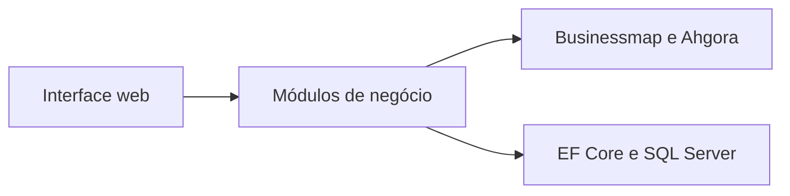

# WorkTime — showcase técnico

> Visão pública e sanitizada do produto. O código-fonte, configurações internas e dados operacionais não fazem parte deste material.

## Visão geral

WorkTime é uma aplicação web para gestão e conciliação de horas. Reúne apontamentos internos, dados do Businessmap/Kanbanize e importações do Ahgora em fluxos de trabalho com jornadas, equipes, fechamentos, férias, relatórios e auditoria.

[Acessar a aplicação WorkTime](https://worktime.devforyou.com.br/account/login) — o acesso às áreas operacionais requer uma conta autorizada.

## Desafio de produto

Consolidar apontamentos que chegam de fontes diferentes e dar suporte às rotinas de equipes, jornadas, férias e fechamentos, preservando histórico e rastreabilidade.

## Abordagem

O WorkTime reúne integrações e registros internos em fluxos de trabalho organizados por módulos. A separação entre apresentação, casos de uso, persistência e integrações permite evoluir cada área de forma incremental.

## Arquitetura em alto nível

- **Aplicação:** ASP.NET Core MVC/Razor sobre .NET 10.
- **Persistência:** Entity Framework Core e SQL Server.
- **Organização:** monólito modular, com fronteiras para áreas como identidade, apontamentos, integrações e notificações.
- **Integrações:** Businessmap/Kanbanize para cartões e sincronização de apontamentos; Ahgora para consulta semanal e importação de horas.

## Engenharia

A aplicação evolui de forma incremental. Serviços de aplicação concentram casos de uso; testes automatizados e verificações arquiteturais ajudam a proteger contratos e fronteiras entre módulos.

## Segurança e auditoria

O produto inclui autenticação baseada em cookies, proteção antiforgery, limitação de requisições e registros de auditoria. Este resumo não publica detalhes de configuração, rotas administrativas ou informações de infraestrutura.

## Escopo deste showcase

Este documento descreve capacidades e decisões em nível de produto. Não inclui código-fonte, credenciais, dados de usuários, regras comerciais internas, topologia de produção ou detalhes operacionais privados.
